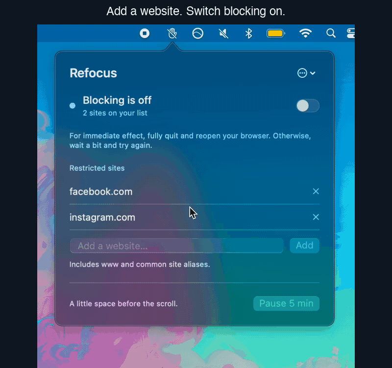

# Refocus

A tiny macOS menu-bar app for system-wide website blocking: one list, an on/off switch, and a five-minute pause. A first line of defense against habitual browsing.

**[Download the DMG](https://github.com/Phionx/refocus/releases)** · [Website aliases](SITE_ALIASES.md) · [Changelog](CHANGELOG.md)

**macOS 13+ · Apple Silicon and Intel · No accounts or browser extensions**



## Install

1. Download **Refocus-VERSION-macOS.dmg** from the release's Assets, not the source-code ZIP.
2. Open it, **drag Refocus into Applications**, then launch Refocus from Applications and eject the DMG.
3. Click its focus-frame icon in the menu bar, review your list, and choose **Enable blocking…**.
4. **Allow the background helper** in **System Settings → General → Login Items** (or **Login Items & Extensions**) under **Allow in the Background**, then return to Refocus. Administrator approval may be required.

**Background approval is required.** The helper updates Refocus's section of the system hosts file; it does not inspect your traffic. This is separate from the optional **Open Refocus at login** setting. **Quitting Refocus turns blocking off.**

The initial release is **ad-hoc signed, not notarized**. If macOS blocks opening, try **System Settings → Privacy & Security → Open Anyway** after the first launch attempt. [Apple's instructions](https://support.apple.com/102445). Managed Macs may disallow this. Do not disable Gatekeeper globally. See the [installation guide](docs/installation.md) for details, uninstalling, and recovery.

## Use

Add domains or paste URLs, then use the switch to block/unblock. **Pause 5 min** temporarily lifts blocking; **Resume now** restores it early. Your list stays saved when you quit; reopening starts off.

**Fully quit and reopen your browser to apply changes immediately, or wait a bit for them to take effect.** Cached connections, VPNs, and private resolvers can bypass this lightweight barrier.

Some websites use aliases. Refocus includes [known aliases](SITE_ALIASES.md), and anyone can contribute to the list.

## Update

1. **Quit Refocus** before replacing it; quitting removes its blocks.
2. Download the newer DMG, drag Refocus into Applications, and choose **Replace**.
3. Reopen it. Your list stays saved and the helper refreshes for the new version. macOS may ask for background approval again. Turn blocking on when ready.

If refresh fails, choose **More options → Refresh background helper**.

**Upgrading from a 0.1.x test build?** First choose **Disable & remove helper** in the old app, then quit and replace it. Version 0.2.0 changes the development identifiers; this extra step is needed once.

## Contribute

Fork the repo, make a focused change, and open a pull request. For mappings, edit **[SiteAliases.swift](Sources/RefocusCore/SiteAliases.swift)** and regenerate the [readable reference](SITE_ALIASES.md):

```sh
bash scripts/update-aliases.sh
bash scripts/test.sh
bash scripts/build.sh
```

Add verified service-specific aliases and relevant regression checks. Tests use disposable files, never your system hosts file. See [CONTRIBUTING.md](CONTRIBUTING.md).

## Build from source

Install Apple's Command Line Tools (`xcode-select --install`), clone this repo, and run the test/build commands above. No third-party dependencies or full Xcode installation are needed. The app is created in `dist/Refocus.app`.

Run `bash scripts/package.sh` for a universal DMG/ZIP with privacy checks and checksums (or use the clean GitHub Actions build). [VERSION](VERSION), [BUILD_NUMBER](BUILD_NUMBER), and matching Git tags identify releases. See [the release guide](docs/releasing.md).

## Privacy and license

No telemetry. Website lists stay local; builds do not include saved settings, credentials, or personal build paths. Published downloads are built on a clean GitHub runner; packaging scans the payload and checks file metadata. [Implementation details](docs/architecture.md).

[MIT licensed](LICENSE), with no-warranty and liability disclaimers. Those clauses do not guarantee exemption from every legal claim. This is an early testing release; installation and updates still need verification on another Mac.
